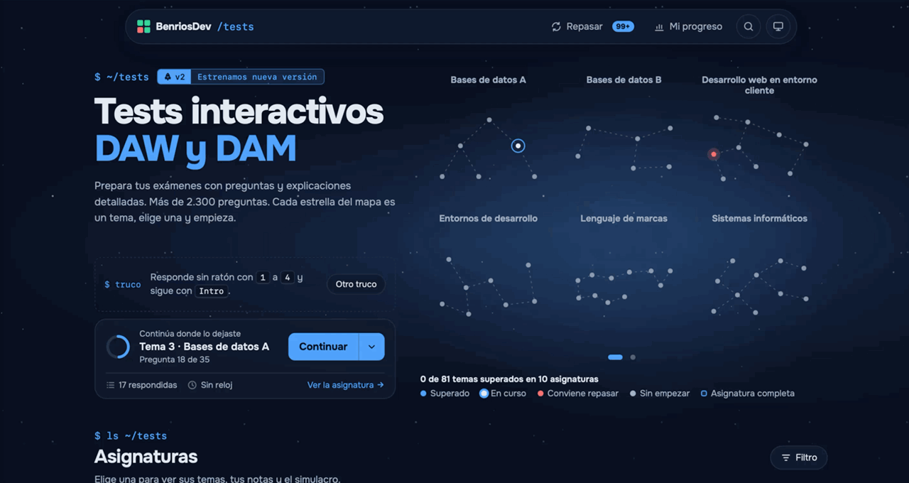
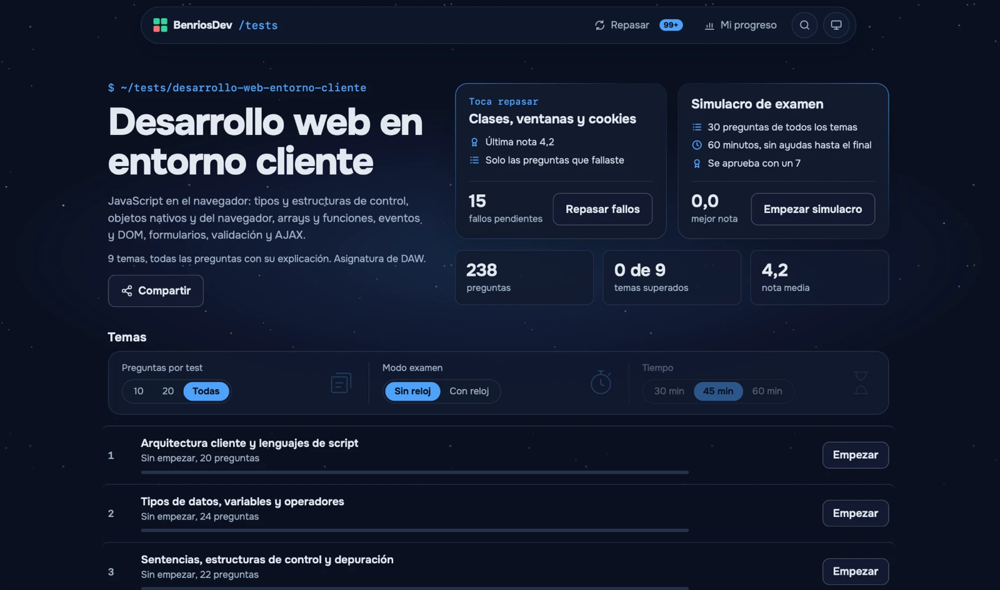
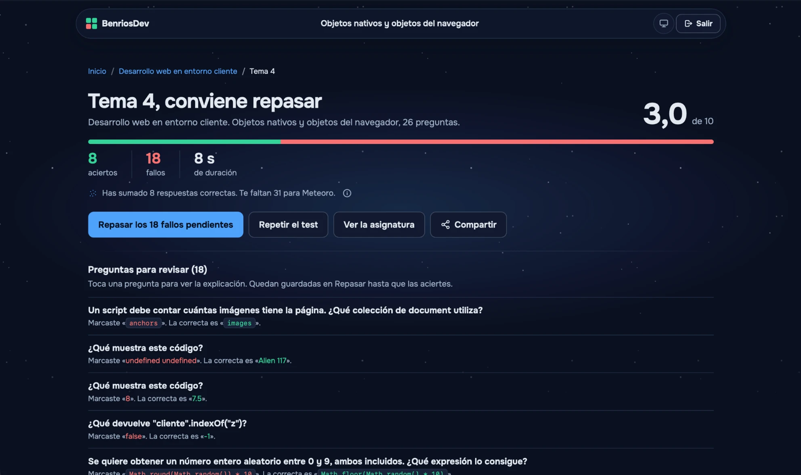
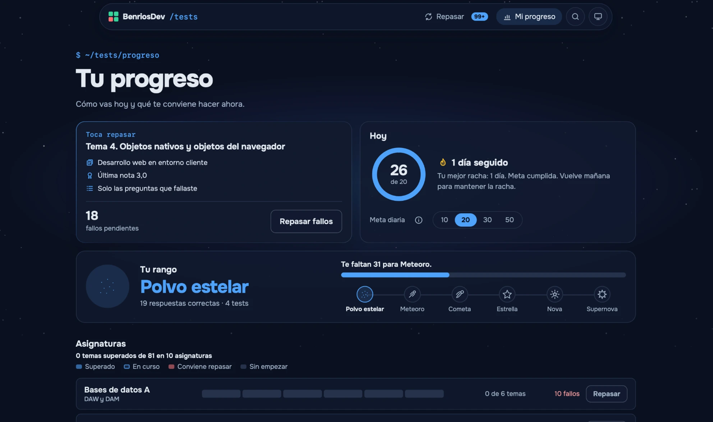
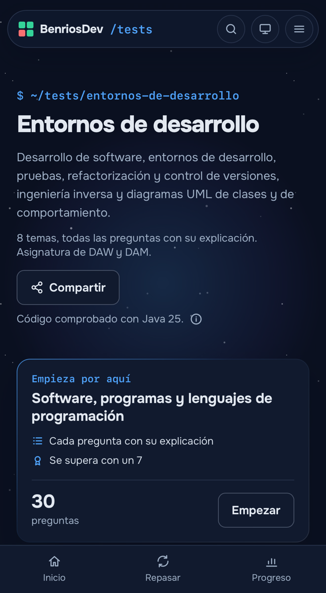
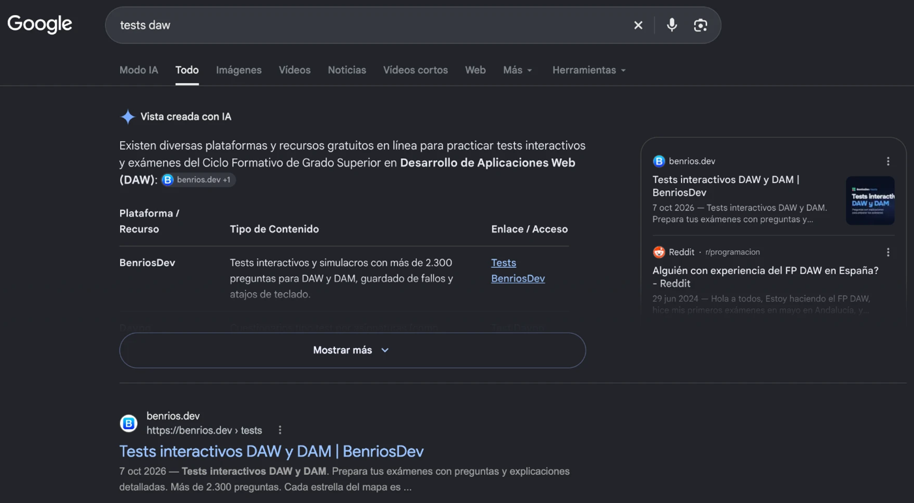
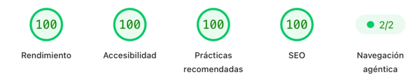
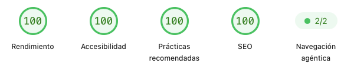
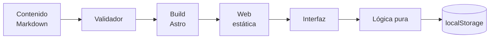

# Tests interactivos DAW y DAM

Tests interactivos para repasar las asignaturas de los ciclos de Desarrollo de Aplicaciones Web y Multiplataforma, con preguntas revisadas y explicadas.

**[Probar la web →](https://benrios.dev/tests/)**

## Por qué existe

Mientras estudiaba DAW y DAM, los tests que encontraba estaban desactualizados, incompletos o tenían preguntas que se acertaban eligiendo la opción más larga. Así que decidí hacer los míos: preguntas propias y revisadas, con una explicación en cada una y ordenadas por asignatura y tema.

También es mi proyecto de aprendizaje. Me sirve para llevar lo que se ve en el ciclo a un producto real y publicado: diseño de interfaz, TypeScript, pruebas automatizadas, accesibilidad, rendimiento y SEO. Con el SEO aprendí a pensar qué debe encontrar un buscador y qué no: sitemap, `noindex`, canonical, datos estructurados y metadatos para compartir. Las decisiones importantes están documentadas con su porqué.

## Cómo lo construí

### Del diseño al código

Antes de escribir una línea, audité la versión anterior de la web para saber qué sobraba y qué faltaba. Después comparé varias identidades visuales en una página propia y elegí una: el cielo quieto, la tipografía Onest y los detalles de terminal. Con ella maqueté un **prototipo navegable** en un solo HTML, con portada, asignatura, test, simulacro, resultados, Repasar y Mi progreso, y lo usé como referencia visual y de comportamiento durante todo el desarrollo.

Solo entonces empecé a construir, por fases: primero la base del proyecto y el validador del contenido, después la lógica del test con sus pruebas, luego la interfaz y al final los extras y la publicación. Cada pantalla nueva o rediseño empezaba con una maqueta de varias opciones antes de tocar el código.

### Trabajar con IA con método

Lo desarrollé con Claude Code como asistente de programación, con estas reglas:

- **Contexto persistente.** Un archivo de instrucciones del proyecto recoge el stack, los comandos, las convenciones y las reglas de diseño ya cerradas, para que cada sesión empiece sabiendo lo que no se discute.
- **Las decisiones como memoria.** Un registro numerado, con más de 90 decisiones, es la fuente de verdad. La IA lo lee al empezar, y cualquier cosa que lo contradiga se pregunta antes de hacerla.
- **Opciones, no hechos consumados.** Cada cambio de diseño o arquitectura llega como varias opciones con una recomendación razonada, y la elección es mía.
- **Sesiones cortas y con un objetivo.** Una tarea por sesión, leyendo solo los archivos necesarios, para que el contexto no se degrade.
- **Revisiones especializadas.** Pautas de diseño antes de proponer una pantalla, revisión de código antes de cada commit y revisión de seguridad antes de publicar.
- **Límites claros.** La IA no hace commits ni publica, no instala nada sin que yo verifique la fuente y lo apruebe, y no usa el navegador sin permiso.

### Verificación

Nada se da por bueno sin comprobarlo. Cada entrega pasa por lo mismo antes del commit:

- `pnpm build`, que valida todo el contenido en modo estricto, comprueba los tipos (`astro check` y `tsc`), construye la web y revisa los 240 archivos generados para que no carguen nada externo ni lleven scripts en línea.
- `pnpm test`, con las 394 pruebas de la lógica y del validador.
- Revisión visual en `pnpm dev`, en tema claro, en oscuro y en móvil, con capturas cuando algo no cuadra.
- Lectura del diff final. Los commits los hago yo, uno a uno.

Después de publicar, se comprueba la web real: un recorrido en ventana privada por todas las pantallas, la consola sin errores, la pestaña Red, `curl` para las respuestas y los metadatos, y PageSpeed Insights.

Las dependencias son las justas, siete: Astro, `yaml` y `sharp` para construir la web, y TypeScript, `@astrojs/check`, los tipos de Node y Vitest para desarrollar. Cada una se verificó antes de instalarla, con versiones exactas y sin aceptar versiones publicadas hace menos de 7 días, como protección frente a paquetes comprometidos.

## Qué ofrece

- **Tests por tema** con corrección al momento y una explicación en cada pregunta.
- **Simulacro de examen** de 30 preguntas y 60 minutos con todos los temas.
- **Repasar** reúne las preguntas falladas y las marcadas hasta que se aciertan.
- **Mi progreso** con racha, meta diaria, logros y rangos.
- **Buscador** de asignaturas, temas y preguntas (Ctrl/Cmd + K).
- Tema claro y oscuro, atajos de teclado y sin cuentas ni registro.

| Asignatura | Resultados | Mi progreso |
|---|---|---|
|  |  |  |

En el móvil, con la barra de navegación abajo:

## Retos técnicos

Algunos de los problemas más interesantes que hubo que resolver:

- **Progreso que no se pierde**, sin cuentas ni servidor: versionado, validado al leer y con respaldo automático si algo se daña.
- **Audio sin archivos**, con la voz del navegador y una barra de progreso afinada con la posición real de la voz.
- **Buscador de 2.300 preguntas sin librerías**, con un índice que solo se descarga cuando alguien busca.
- **Constelaciones generadas** con un árbol de expansión mínima y una semilla sacada del nombre de cada asignatura.

Todos los retos, con fragmentos de código, y los errores que encontramos por el camino están en [docs/retos.md](docs/retos.md).

## Rendimiento y SEO

El SEO y el rendimiento se trabajaron con mucho cuidado, página a página, para exprimir cada detalle. Funcionó: al buscar «tests interactivos daw dam», Google muestra la web la primera, tanto en la vista creada con IA como en los resultados (octubre de 2026).

Lighthouse en la portada (PageSpeed Insights):

| Móvil | Escritorio |
|---|---|
|  |  |

Cómo se consiguió, en [docs/retos.md](docs/retos.md#seo).

## Arquitectura

Todo se genera en la build y llega al navegador como archivos estáticos. En el navegador, la interfaz solo pinta y llama a la lógica pura, y el guardado pasa por una sola pieza.

## Stack y cifras

- **Astro** con salida estática, **TypeScript** y CSS propio, sin framework de UI.
- **Vitest** para las pruebas.
- 10 asignaturas y 2.321 preguntas.

Las decisiones de diseño, con su porqué, están en [docs/decisiones.md](docs/decisiones.md), y los retos técnicos y los errores, en [docs/retos.md](docs/retos.md).

## Sin backend, de momento

La web es estática a propósito. El progreso vive en el navegador, así que no hace falta registrarse ni se guardan datos personales, carga rápido y se aloja en un hosting sencillo, sin un servidor que mantener ni proteger. Para empezar, era lo más simple que funcionaba.

No descarto una versión con backend en el futuro, por ejemplo con cuentas para sincronizar el progreso entre dispositivos. La lógica ya está separada de la interfaz y todo el guardado pasa por una sola pieza, así que cambiar dónde se guardan los datos no obligaría a rehacer la web.

## Código fuente

El código fuente es privado. Este repositorio es un escaparate del proyecto. Todos los derechos reservados.

Hecho por [BenriosDev](https://benrios.dev).
